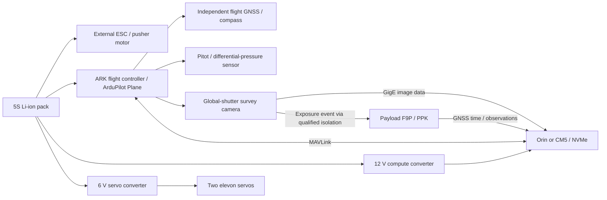

# Survey-wing hardware specification

This is a dedicated new-build specification. The existing OAK/PX4 platform
continues to use its own hardware profile in `mapping_functionality`.
Machine-readable selections are in the packaged YAML inputs; generated CSVs
list quantities, mass, power, sources and confirmation items separately for
Orin and CM5. Empty prices mean a quote is required. This is an engineering
review revision, not a purchasing or flight release.

## System architecture

The camera supply is the FC's regulated 12 V output in the current budget.
The diagram's FC-to-camera line represents this power path, not a direct
unqualified logic connection. Pin assignments remain subject to the exact
board revisions and measured signal voltages.

## Camera decision

| Candidate | Role | Qualification still required |
|---|---|---|
| Basler a2A5320-7gcPRO / IMX542 | Preferred sizing candidate, GigE, global shutter, C mount | Availability; selected pixel format; exposure-event electrical levels; pylon ARM capture; cable/connector clearance |
| Allied Vision Alvium G1-1620 / IMX542 | Same-format vendor alternative | Colour SKU and throughput; I/O timing; driver support; housing mass/drawing and connector clearance |
| Other hardware-triggered global-shutter camera | Allowed if it meets the capability contract | Recompute GSD/overlap/blur, mass, power, storage and cage CAD; never reuse intrinsics or lever arms |

The baseline lens is the Kowa LM25FC24M 25 mm C-mount. The camera and
survey antenna form a single rigid cage, with vibration isolation below the
whole assembly. Camera/antenna calibration must be tied to the actual camera,
lens, focus, serial numbers, cage revision and measured lever arm. The Basler
candidate's published 7 fps is not a guarantee for every bit depth/transport
configuration. Acquisition rate has its own configured limit and must be
validated at the chosen format.

The old `a2A5328-4gcPRO` designation referred to a different, larger IMX540
sensor. It is not an interchangeable BOM spelling. See the manufacturer links
in [critical_review.md](critical_review.md).

## Electronics and harness deliverables

- `electronics/bom_orin.csv` and `electronics/bom_cm5.csv`: airframe electronics,
  payload members, chosen compute, storage, harness and battery inventory.
- `electronics/power_budget.json` and `peak_power_budget.json`: typical and peak-assumption budgets,
  conversion losses and pack load; propulsion is accounted for separately by
  the aircraft model.
- `electronics/open_items.txt`: confirmation queue from every unresolved BOM row.

| Connection | Required interface | Integration check |
|---|---|---|
| Battery → ESC/FC/converters | 5S operating range, fused/qualified distribution | Polarity, current, connector heating and low-voltage margin |
| FC → elevons | Two independent PWM channels through servo rail | Current at stall, direction, failsafe and mechanical travel |
| FC ↔ flight GNSS | DroneCAN per selected module | Bus power, termination and compass installation |
| FC ↔ airspeed | Supported sensor interface | Exact breakout, pressure ports and calibration |
| FC ↔ companion | Dedicated MAVLink serial interface | Board voltage levels, bandwidth, heartbeat and timesync |
| Camera ↔ companion | GigE point-to-point | MTU/buffers, packet loss, sustained recording and recovery |
| Camera exposure ↔ F9P event input | Conditioned/isolated pulse | Voltage, polarity, pulse width, delay and event correlation |
| F9P ↔ companion | GNSS observations/events plus time reference | Raw observations, time validity, dropped-event detection |
| Companion ↔ NVMe | Carrier-supported PCIe/storage | Sustained write test at temperature with reserve capacity |

There is no released pin-by-pin harness drawing yet because several exact
SKUs and board revisions remain open. Treat this table as the interface
schedule for the next wiring revision, not an instruction to connect unknown
signal levels.

The CM5 option assumes its eventual carrier accepts the configured 12 V compute
supply and provides its own module regulation. A 5 V-only carrier requires a
different converter and a rerun of the rail budget; do not connect a CM5 module
directly to the 12 V rail.

The ESC candidate is the [Castle Talon 60, 010-0163-00](https://www.castlecreations.com/en/talon-60-6s-25-2v-60-amp-esc-with-20-amp-bec-010-0163-00),
rated 60 A and 2–6S, with a published mass of 57 g including wires. This replaces
the insufficient 40 A placeholder. The rating assumes specified cooling; qualify
it at the mission temperature. Keep the separate servo regulator and isolate the
ESC's unused BEC positive lead. Its proprietary telemetry capability does not
establish ArduPilot telemetry support. Verify brake and Li-ion cutoff settings.

## Mechanical and release criteria

STEP parts use the aircraft reference frame; STL parts are rotated and placed
for the configured printer. The manifest pairs each STL and STEP and records
material, settings, estimated mass and fit. The STEP assembly represents the
printed parts; bought-in electronics and tubes are accounted for in the mass
report and are not vendor-accurate CAD models.

Before ordering or printing an entire airframe, confirm camera and pack
envelopes, make fit coupons for critical joints, and resolve the folding-prop
envelope. Then weigh actual assemblies, enter measured mass/CG corrections,
verify propulsion and cooling on the bench, and validate the complete mapping
capture chain with a stationary and walking dataset. These are evidence gates
for the physical prototype; they do not prevent regenerating review artifacts.
