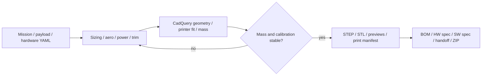

# Survey wing: design to artifacts and assembly review

## Rebuild and inspect

Run `python scripts/build_parts.py --review-out outputs/review` from the repo.
Calibration passes only when wing, pod and cage mass corrections are stable
and sizing mass agrees with CAD balance mass within 1%. The calibration saved
is the one actually used to generate the successful geometry. Exhaustion is an
error; the prior calibration remains intact. Other payloads use `--no-converge`
on the airframe sized for `payload.size_for`.

Review `index.html` first, then `design_summary.json` and the mechanical manifest.
Compare static margin and the attainable battery location; a target CG can be
outside the physically configured bay even when the pack fits the shell. All
STL/STEP names must match the part manifest. STL coordinates are arranged for
printing, while STEP coordinates use the aircraft frame. Keep that distinction
when importing parts into another CAD system.

## Change the design

Change mission/site values under `mission/`; survey, structure and aerodynamic
assumptions in `platforms/survey_wing/design_point.yaml`; payload parts and their
envelopes in `payload/survey_cage.yaml`; battery/airframe electronics in
`electronics.yaml`; printer volume, materials and fabrication datums in
`fabrication.yaml`. The model rejects inconsistent duplicated battery cell
values. The camera candidate's resolution, frame rate, mass, optical-axis
length and typical power must be updated together.

Use the printed mass model only as an estimate. A new material, nozzle, extrusion
width or foaming profile requires a coupon, slicer comparison and scale reading.
Printer fit includes the configured bed margin and orientation; support volume,
warping and strength are not proven by the bounding check.

The baseline remains hand launch. The bungee sizing trade and optional hook
geometry are concepts, with the hook load path requiring a structural backing
attachment and ground proof testing. A larger pack must also pass launch,
physical envelope and CG checks; extra energy alone does not establish a valid
configuration.

## Print and assembly sequence

1. Print tolerance coupons for carbon tube clearance, split alignment, cage
   dampers, motor slots and hatch magnets. Resolve the actual vendor dimensions.
2. Obtain and measure spars, joiner and sleeves; dry-fit the spar box and wing
   roots before printing the entire set.
3. Print wing segments in manifest orientations. Dry-fit dowels, tubes and
   chordwise splits, then bond with the chosen material-compatible process.
4. Fit servo wiring and covers, elevons, horn hardware and hinges. Check full
   deflection, neutral position, free motion and backlash before sealing access.
5. Fit tip fins using their modeled mating feet; inspect bonded area and alignment.
6. Assemble pod segments, joint rings, spar box and landing skids. Match hatch
   tongues/pockets and magnet polarity; verify retained hatches cannot open under
   expected loads. Glue and hardware masses belong in the measured rollup.
7. Fit the rigid camera/antenna cage on the four dampers. Confirm damper axes,
   compressed stack, lens/window clearance and cable routing. Keep isolation
   below the complete calibrated camera-to-antenna structure.
8. Fit the chosen battery tray with supports, straps and positive stops. Two bay
   trays are exported as alternatives; the mass estimate conservatively includes
   both. Verify retention under acceleration and pack removal access.
9. Install compute, power electronics and air duct. Confirm fan direction,
   unobstructed inlet/outlet and the actual heatsink adapter. Test at ground idle
   as well as representative airspeed; inlet-area arithmetic is not a cooling test.
10. Install propulsion only after verifying shaft/hub compatibility, current,
    brake operation and both deployed and folded blade clearance. The existing
    deployed-plane check does not model a specific folded blade assembly.

Use `PRINT_LIST.md` for per-part material, infill, perimeter and support guidance.
Bought-in electronics/tubes are in mass/BOM data; the STEP assembly comprises
printed parts and should not be mistaken for vendor-accurate complete equipment.

## Measure the assembled CG

Weigh each completed part and installed item including glue, connectors, wiring,
fasteners and retained hatch hardware. Record each mass and position in the
same aircraft datum. The nominal battery position is reported in the manifest
with its bay and height. Place the real flight-ready aircraft on a balance
fixture at the target CG station, with the actual payload and battery fitted.
Move the battery only within its verified supported range, then re-secure it.
Record actual CG and compute `(neutral_point_x - cg_x) / MAC`; the neutral point
is a model estimate. If the target cannot be reached, revise layout or washout
and regenerate the model rather than treating a clamped battery solution as
an achieved target. Repeat for Orin/CM5 and every pack or camera change.

## Software integration and qualification

The package includes a design handoff and nominal rig template, not a flight
mission or measured camera calibration. The existing OAK/PX4 workflow is retained.
The new wing needs the capabilities in mapping issues
[#27](https://github.com/WalleringRobotics/mapping_functionality/issues/27) and
[#28](https://github.com/WalleringRobotics/mapping_functionality/issues/28).
Follow the software specification for camera/event correlation, data sealing,
clock domains, storage/thermal soaks, offline processing and plan validation.

Bench/simulator evidence precedes an operator-reviewed physical test. Purchasing,
launch-method choice and flight testing remain user decisions from the original
handoff. The build tool performs none of those operations.
